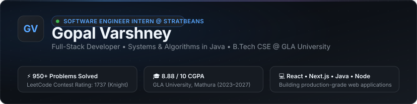

  

 

### 👋 Hi, I'm Gopal

Full-stack developer and **Software Engineer Intern at [Stratbeans Consulting](https://stratbeans.com)**. I build reliable web products with **React, Node.js, Express, and MongoDB**, with a particular interest in practical AI-enabled experiences.

**Open to SDE intern and new-grad opportunities.**

[Portfolio](https://gopalvarshney-portfolio.vercel.app) · [LinkedIn](https://www.linkedin.com/in/gopal-varshney-99b0b0366/) · [LeetCode](https://leetcode.com/u/Gopal_Varshney/) · [Email](mailto:gopal.varshney13@gmail.com)

- 🎓 B.Tech, Computer Science & Engineering, GLA University (2023–2027) — **8.88 / 10 CGPA**
- 🧠 **950+ LeetCode problems** solved; **1737 contest rating** (Knight badge, top 15% globally)
- 📍 Mathura, Uttar Pradesh, India

---

### 🚀 Featured Projects

<table width="100%">
  <tr>
    <td width="50%" valign="top">
      <h4>⚡ <a href="https://github.com/GopalVar2005/Scriptly">Scriptly — AI Study Platform</a></h4>
      
Full-stack AI study platform generating structured notes, flashcards, summaries, and quizzes from audio, video, and YouTube links with Gemini and Groq fallback.

      

        
        
        
        
      

      

        <a href="https://scriptly-ashen.vercel.app/"><b>Live Demo ↗</b></a> &nbsp;|&nbsp;
        <a href="https://github.com/GopalVar2005/Scriptly"><b>Repository →</b></a>
      

    </td>
    <td width="50%" valign="top">
      <h4>📚 <a href="https://github.com/GopalVar2005/Learnify-Full-Stack-Learning-Web-App">Learnify — Learning Management System</a></h4>
      
Learning platform with instructor dashboards, Cloudinary video hosting, lesson-progress tracking, and role-based session authentication across 17 REST endpoints.

      

        
        
        
        
      

      

        <a href="https://github.com/GopalVar2005/Learnify-Full-Stack-Learning-Web-App"><b>Explore Repository →</b></a>
      

    </td>
  </tr>
  <tr>
    <td width="50%" valign="top">
      <h4>🌐 <a href="https://github.com/GopalVar2005/GopalVarshney-Portfolio">Developer Portfolio</a></h4>
      
High-performance personal website built with Next.js 16 (App Router), TypeScript, and Tailwind CSS v4 with zero-database cold starts, dynamic mascots, and HTTP security hardening.

      

        
        
        
      

      

        <a href="https://gopalvarshney-portfolio.vercel.app"><b>Live Website ↗</b></a> &nbsp;|&nbsp;
        <a href="https://github.com/GopalVar2005/GopalVarshney-Portfolio"><b>Repository →</b></a>
      

    </td>
    <td width="50%" valign="top">
      <h4>🧠 <a href="https://github.com/GopalVar2005/DSA">DSA Problem Solutions</a></h4>
      
Curated archive of 950+ algorithmic problem solutions in Java covering Data Structures, Dynamic Programming, Graph Theory, and Tree traversals with complexity analyses.

      

        
        
        
      

      

        <a href="https://github.com/GopalVar2005/DSA"><b>Explore Solutions →</b></a>
      

    </td>
  </tr>
</table>

---

### 🛠️ Technical Arsenal

<b>Languages</b>

  
  
  
  
  

<b>Frontend Development</b>

  
  
  
  
  

<b>Backend & Database</b>

  
  
  
  

<b>Tools & Workflow</b>

  
  
  
  
  
  

---

### 🧠 Algorithmic Problem Solving

Consistent algorithmic problem-solving practice focused on time and space complexity optimization, data structures, and graph algorithms:

- ⚡ **LeetCode**: **[leetcode.com/u/Gopal_Varshney](https://leetcode.com/u/Gopal_Varshney/)** — **950+ Problems Solved** • **1737 Contest Rating** (Knight Badge, Top 15% globally)
- 🏆 **Codeforces**: **[codeforces.com/profile/GopalVar](https://codeforces.com/profile/GopalVar)**
- 📁 **Algorithms Archive**: **[github.com/GopalVar2005/DSA](https://github.com/GopalVar2005/DSA)**

---

### 🌐 Let's Connect

  
  
  
  

